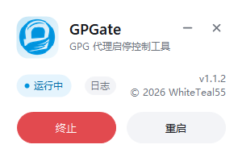

# GPGate

用于 `gpg-agent`、`keyboxd` 与 `scdaemon` 的启停管理，封装为单条命令。

## 用法

```
GPGate.exe /s   启动
GPGate.exe /k   终止
GPGate.exe /r   重启
GPGate.exe /g   打开图形界面
GPGate.exe      自动切换（正在运行就停止，未在运行就启动）
```

参数不区分大小写。参数多余时程序报错退出，返回码 `2`。

双击运行时进入图形界面。

在终端中调用不会阻塞 shell，获取退出码请使用：

```
$p = Start-Process GPGate.exe /s -PassThru; $p.WaitForExit(); $p.ExitCode
```

不要加 `-Wait`：它会连带等待 `gpg-agent`，看起来像卡死。

退出码含义：`0` 成功，`1` 失败，`2` 参数错误。

仅支持 Windows 11 x64。`gpgconf.exe` 与 `gpg-connect-agent.exe` 必须位于 PATH 中。

## 图形界面

界面为无边框圆角卡片，支持深色、浅色与跟随系统主题，按 DPI 缩放。右上角太阳/月亮按钮可在深浅色间切换；托盘右键菜单可选择「深色」「浅色」或「跟随系统」，设置会保存。

顶部区域可拖动。Esc 关闭窗口，F1 打开关于。

`–` 最小化至托盘，单击托盘图标即可恢复。`×` 为退出，默认需二次确认（可勾选「不再提示」）。若当前有操作正在执行，程序会等待该操作完成后再退出。等待期间界面锁定，不响应点击。操作失败时程序不退出，在界面上提示错误。

界面只呈现当前可用的操作，状态每 2 秒刷新，窗口收起后降为 5 秒。状态行右侧为「日志」与版本号。

窗口图标与任务栏图标右上角显示状态圆点。蓝色为运行中，灰色为未运行。

 

托盘右键菜单为系统原生菜单，跟随主题配色。窗口收起后托盘图标照常刷新，打开菜单时也会先查一次。

菜单包含显示窗口、启动/终止/重启、主题模式、开机自启、退出时二次确认、打开日志与关于。关于页显示版本、版权与图标署名。

程序已在运行时，再次启动或执行 `/g` 均不会创建新实例。已有实例将被唤至前台。3 秒内未能唤出时会弹出提示。

## 构建

需要 .NET 10 SDK，两种发布方式可一次生成。仓库内也提供了对应的 VS Code 任务（`构建：框架依赖版本`、`构建：自包含版本`）。

框架依赖版本约 690 KB，运行时需安装 .NET 10 桌面运行时：

```
dotnet publish src/GPGate/GPGate.csproj -c Release -r win-x64 --self-contained false -p:PublishSingleFile=true -o publish
```

自包含版本约 50 MB，无需安装运行时。代价是首次启动延迟约半秒：

```
dotnet publish src/GPGate/GPGate.csproj -c Release -r win-x64 --self-contained true -p:PublishSingleFile=true -p:EnableCompressionInSingleFile=true -o publish-standalone
```

## 项目结构

```
├─ src/                源码
│  ├─ GPGate.sln       解决方案
│  └─ GPGate/
│     ├─ Program.cs    入口、参数解析、退出码
│     ├─ Core/         应用信息、日志、开机自启
│     ├─ Gpg/          GPG 进程控制与动作锁
│     ├─ Ui/           窗口、对话框、托盘、自绘路径
│     │  ├─ Controls/  自绘按钮与详细信息框
│     │  ├─ Interop/   Win32 互操作：图标、单实例、前台
│     │  └─ Theme/     配色与深浅色刷新
│     └─ Assets/       图标与改动说明
├─ docs/               README 截图
├─ tools/              图标生成脚本
├─ .github/            CI：手动或打 tag 触发构建，打 tag 时发布 Release
└─ .vscode/            构建任务
```

## 图标与许可

图标基于 GnuPG 官方 artwork 派生，采用 CC BY-SA 4.0。改动说明见 `src/GPGate/Assets/README.md`。

代码采用 MIT 许可，见 `LICENSE`；图标为 CC BY-SA 4.0。本项目与 GnuPG 项目无隶属关系。

## 说明

启动会拉起 `gpg-agent`、`keyboxd` 与 `scdaemon`，终止则一并结束。启用了 `disable-scdaemon` 时跳过 `scdaemon`。单个子进程超过 10 秒未退出即判定为失败。

运行状态只看进程名，不区分登录会话与用户：三个组件有任意一个在跑就算运行中，别的用户在跑时同样显示「运行中」。

界面只有深色、浅色两套配色，不跟随系统的高对比度主题。

同时只允许一个操作，已有操作在跑时新的调用立即返回失败，不排队。

任一环节失败时，对话框会一并给出子进程的错误输出。日志位于 `%TEMP%\GPGate\gpgate.log`，按行记录，超过 512 KB 轮转为 `.old`。

在无控制台环境下，参数错误和执行失败同样以对话框提示。完整用法置于对话框的展开区域中。

开机自启由托盘菜单控制。未勾选「自启时启动托盘」时，开机只静默启动，不显示托盘图标。设置写入失败时会提示需要管理员权限。

退出确认默认开启。可在确认框中勾选「不再提示」，也可在托盘菜单的「退出时二次确认」里开关。
